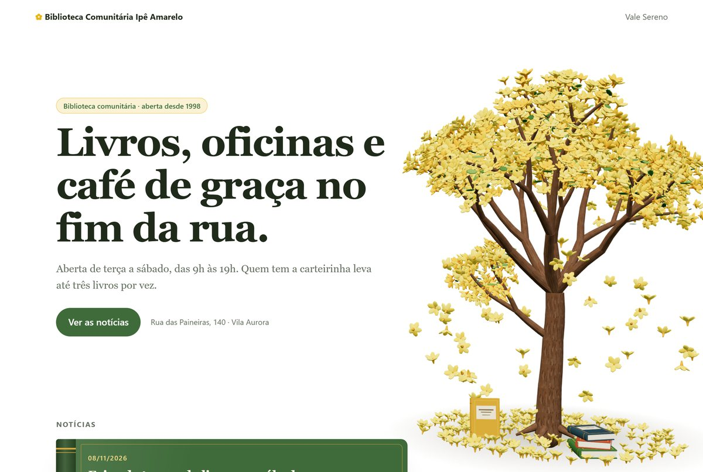
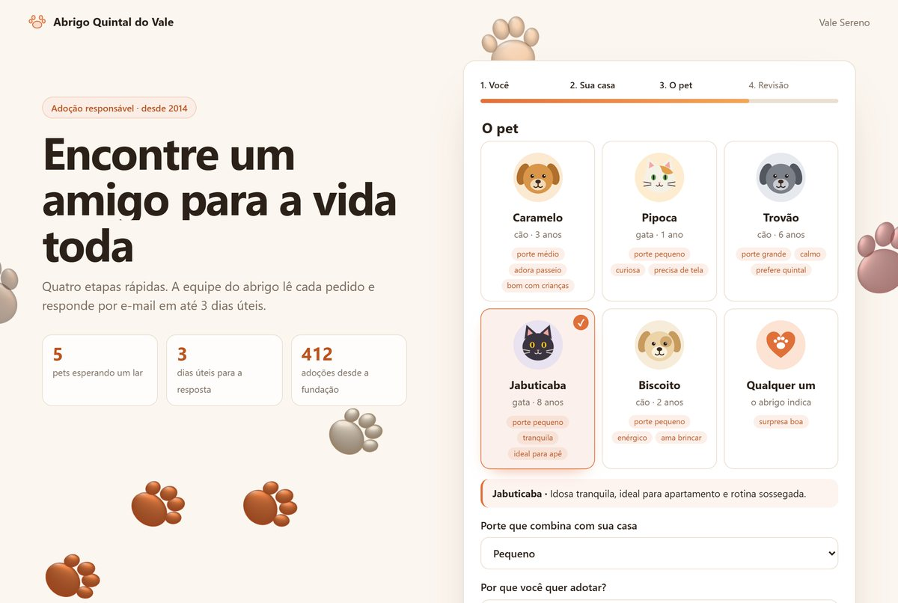

# Arthur Lopes

Desenvolvedor em Ribeirão Preto (SP) e estudante de Engenharia de Software (UNAERP, formatura em 2027).
Trabalho com **dados, integrações e automação**, e uso **agentes de IA** todos os dias, do levantamento ao deploy.

[LinkedIn](https://www.linkedin.com/in/arthur-lopes-b34ba6367/)

## O que eu faço

- **Integrações e automação:** APIs REST e GraphQL, webhooks, n8n e Pipefy ligando processos entre áreas.
- **Dados:** modelagem e SQL em PostgreSQL, MySQL, Oracle e SQLite.
- **Aplicações web:** PHP, JavaScript/TypeScript (React) e Python.
- **IA aplicada:** Claude Code com servidores MCP e skills próprias.
- **LGPD na prática:** consentimento, coleta mínima, acesso por perfil.

## Projetos em destaque

Os dois rodam de verdade e usam empresas, cidades e dados fictícios.

### [painel-bastidores](https://github.com/ArthurLopes-dev/painel-bastidores)

Site de notícias com painel administrativo em PHP 8 e SQLite, sem framework.

- **Segurança:** login com bloqueio de tentativas, perfis conferidos no servidor, CSRF em todo POST, CSP estrita e SQL só com parâmetros. Passou por revisão de segurança, e as decisões estão explicadas no README.
- **Privacidade:** contador de visitas sem cookie e sem guardar IP.
- **Visual:** ipê-amarelo em 3D gerado por código (three.js) e animações com anime.js.

### [adocao-em-etapas](https://github.com/ArthurLopes-dev/adocao-em-etapas)

Formulário em quatro etapas que transforma cada pedido em um card no Pipefy, pela API GraphQL.

- **Integração:** mapeamento de campos em configuração, sem token no código, e modo demonstração para rodar sem conta.
- **Validação no servidor**, com proteção contra robôs e limite de envios.
- **LGPD:** consentimento com versão do termo e coleta mínima.

## No trabalho

O código do dia a dia é privado. Em linhas gerais, é isto que eu entrego:

| Frente | O que entreguei | Tecnologias |
|---|---|---|
| CRM comercial | Cadastro e acompanhamento de novas empresas, com diagnóstico gerado a partir da base enviada pelo cliente e acesso restrito | PHP, MySQL |
| Automações entre áreas | Processo da venda à implantação ligado por webhooks, faturamento recorrente agendado e régua de e-mails de eventos | n8n, Pipefy (GraphQL), Microsoft Graph API |
| Portal de aprovações | Aprovação por link, com login, auditoria e controle de acesso | PHP |
| Sites institucionais | Migração de plataforma no-code para código próprio, com blog, área administrativa, links rastreáveis e contador de visitas | PHP, SQLite, JavaScript |
| Gestão hoteleira (projeto próprio) | App desktop com reservas, check-in, contas, caixa e relatórios; acesso por perfil no banco, gravações atômicas e cache offline | Tauri, React/TypeScript, PostgreSQL |

## Como trabalho com IA

Uso o Claude Code em todo o ciclo: levantar a demanda, escrever, testar em navegador e publicar. Ligo o agente
aos sistemas por MCP e escrevo skills próprias com documentação verificada, que também usei para treinar colegas.
As páginas passam por testes automatizados em navegador antes de ir ao ar; nos projetos acima, os commits registram o porquê de cada decisão.

## Formação

- Bacharelado em Engenharia de Software, UNAERP (2024–2027)
- Fundamentos de Engenharia de Dados e Python para Análise de Dados, Data Science Academy (em andamento)
- LGPD e Projetos de Sistemas de TI, Fundação Bradesco
